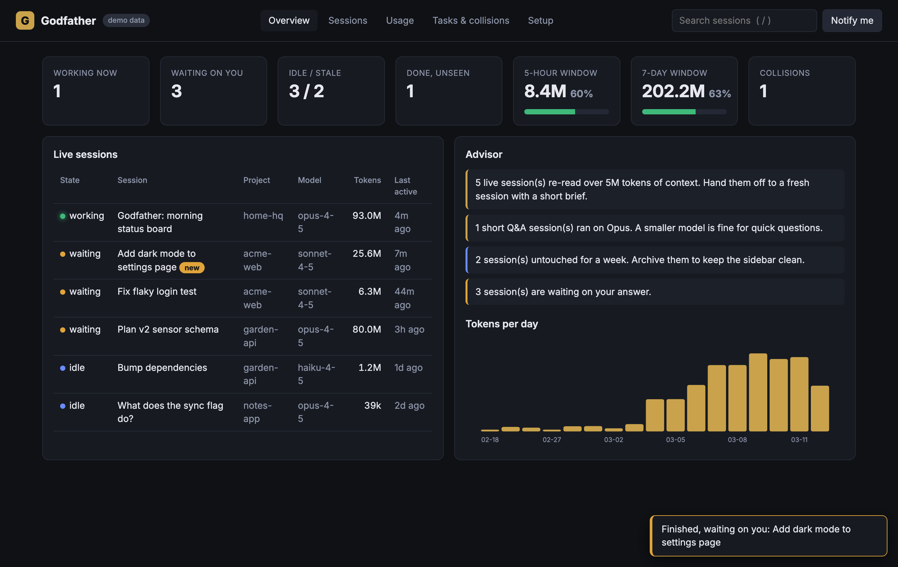
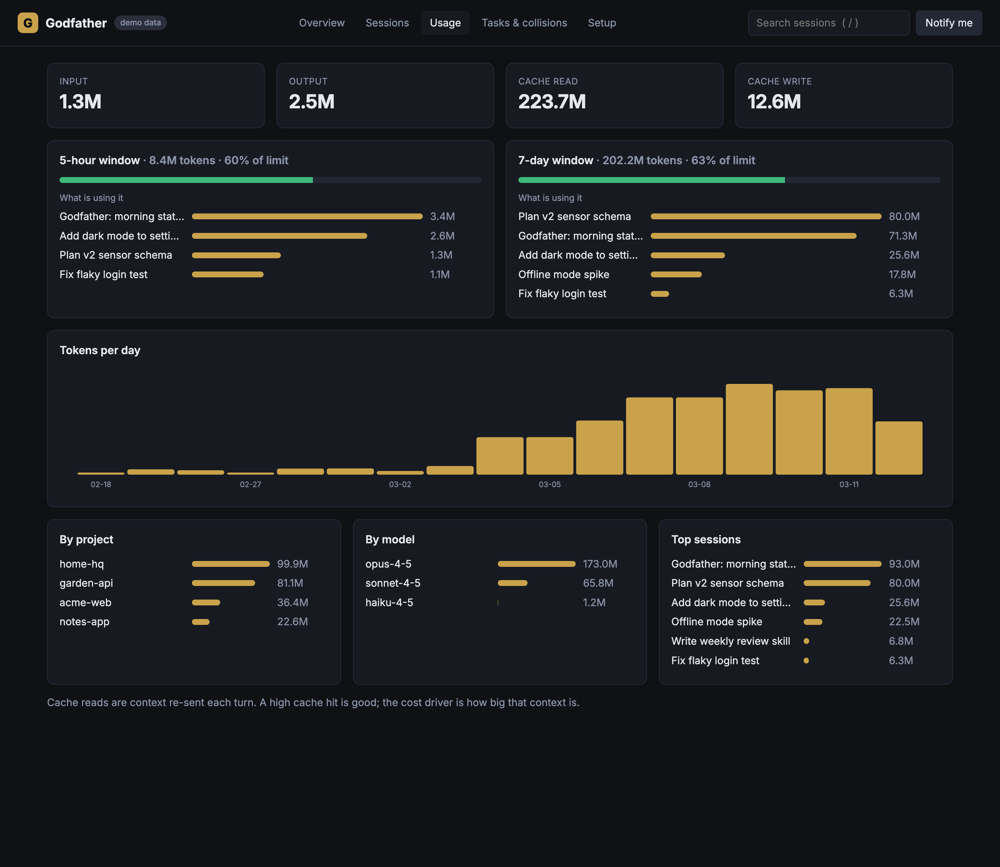
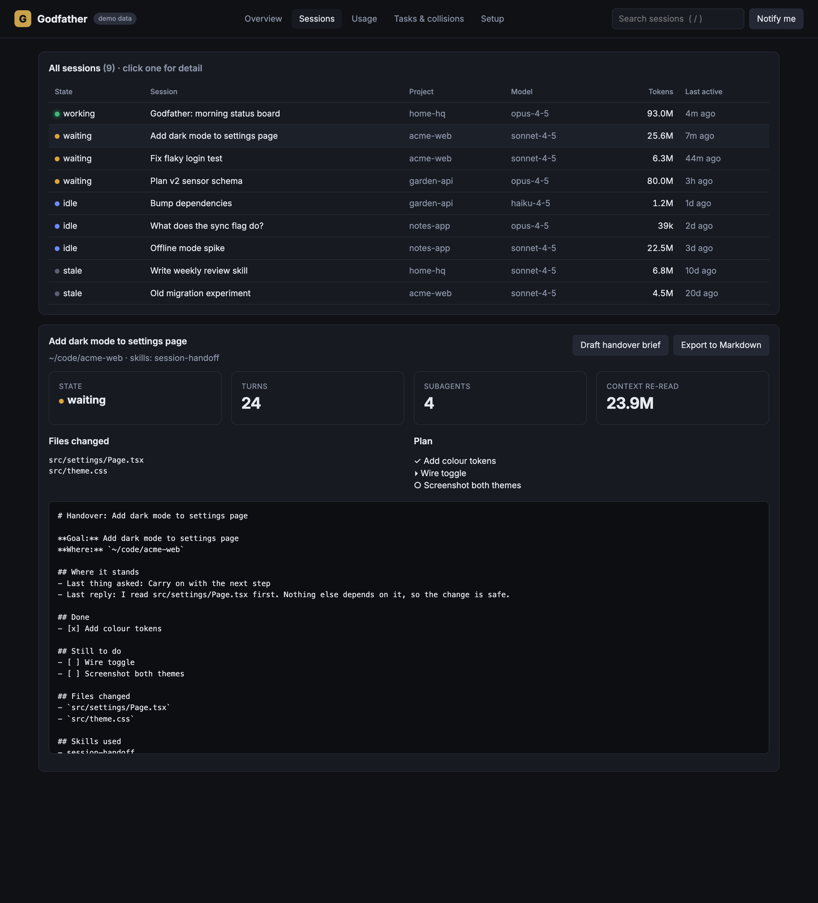
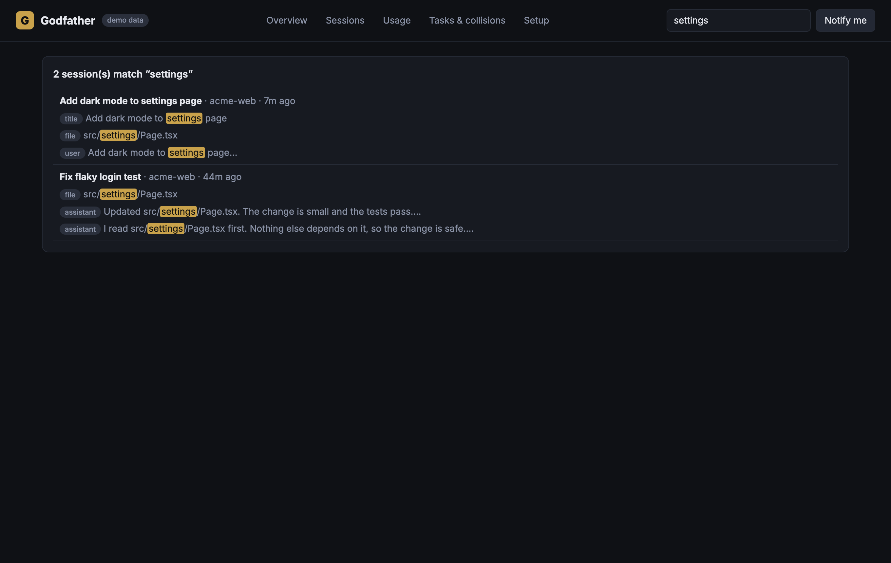
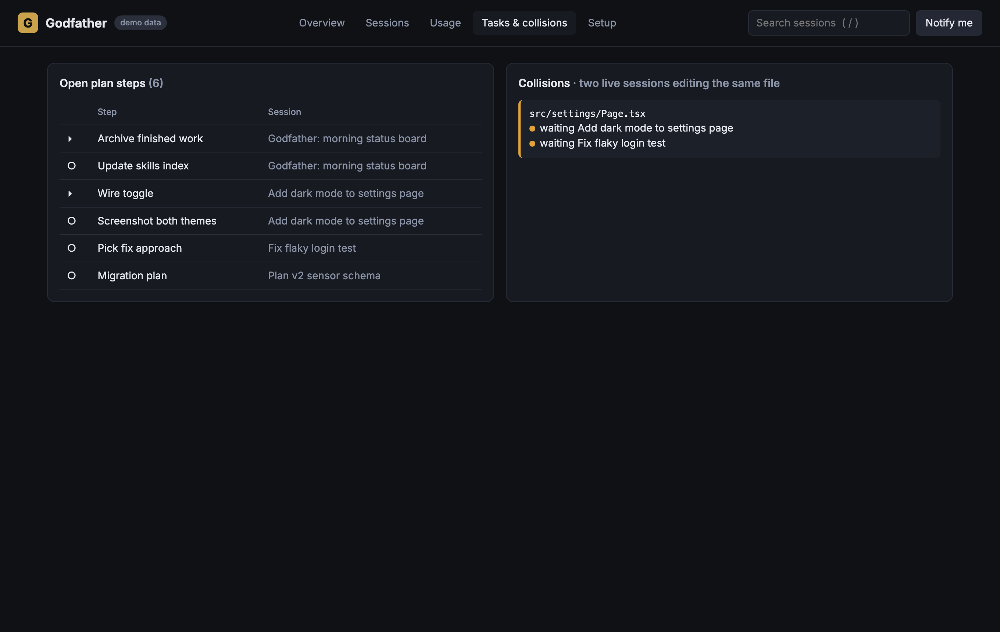
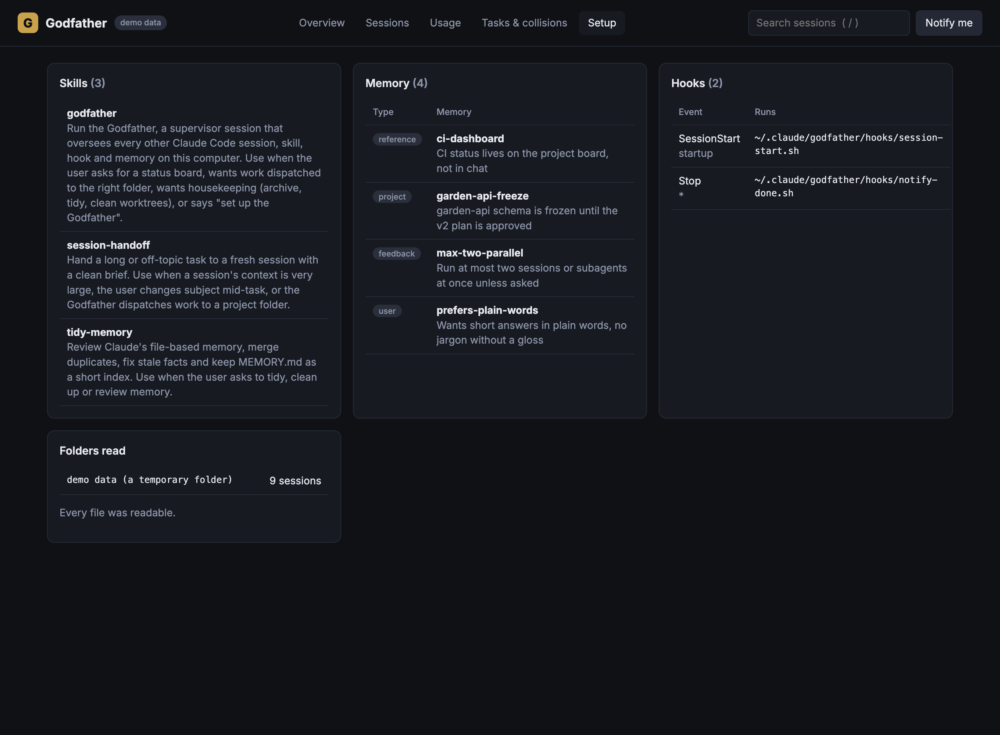
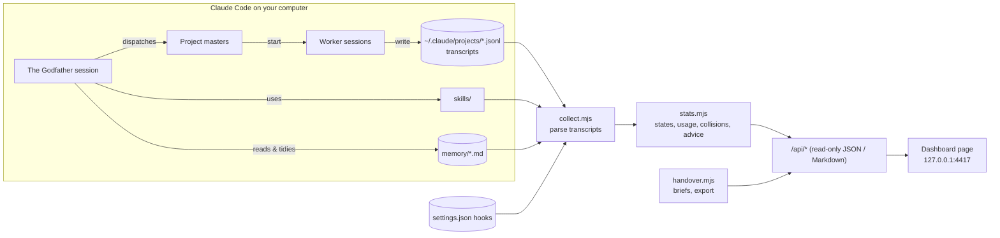

# Godfather

**A supervisor setup for Claude Code.** One pinned session (the Godfather) watches every other session, keeps skills, hooks
and memory tidy, and hands work to the right place. A local dashboard shows what is running, what is waiting on you,
where your tokens went and which sessions are about to edit the same file.



*All screenshots use the made-up demo data that ships with the repo (`npm run demo`).*

## Why

With five or ten Claude Code sessions open, it gets hard to answer simple questions: Which ones are still working? Which
are waiting for me? Are two of them changing the same file? What used up my token budget? The Godfather answers those in
one place, and gives Claude a short set of rules (skills) for running many sessions without chaos.

## Quick start

Needs Node 18+ and bash. No packages to install.

```bash
git clone https://github.com/chamu262/godfather.git && cd godfather
```

```bash
./install.sh
```

```bash
npm run demo
```

Open http://127.0.0.1:4417. `npm run demo` uses made-up data; `npm start` reads your real `~/.claude` folder.
Within about 15 seconds the demo clock moves on and one session finishes, so you see the "finished, waiting on you" notice.
Then, in any Claude Code session, say **"set up the Godfather"**.

Check what is set up at any time (changes nothing):

```bash
./install.sh --check
```

## What you get

| Piece | What it does |
|---|---|
| `install.sh --check` | A doctor: Node version, skills, templates, hooks and whether the dashboard is running, each marked ok, missing or optional. |
| `scripts/wait-idle.mjs` | Waits until no session is working, then exits. Run it before housekeeping so nothing changes under a busy session. |
| `install.sh` | Copies the skills into `~/.claude/skills/` and the templates into `~/.claude/godfather/`. Never overwrites your files (unless `--force`) and never edits `settings.json`; it prints the hook lines for you to paste. |
| `skills/godfather` | The supervisor's rules: status board, dispatch work instead of doing it, check before reporting, ask before deleting. |
| `skills/session-handoff` | How to hand a big or off-topic task to a fresh session with a brief under 300 words. |
| `skills/tidy-memory` | Merge duplicate memories, fix stale facts, keep `MEMORY.md` a one-line index. |
| `templates/` | A `CLAUDE.md` for the Godfather's folder, a memory layout example and two optional hooks (a start-of-session reminder and a "turn finished" notification). |
| `dashboard/` | A small local web page. No dependencies, no model calls, listens on `127.0.0.1` only, reads files read-only. |
| [`docs/conventions.md`](docs/conventions.md) | Session names, one-task-per-session, reports, memory and safety habits. |

## The dashboard

| | |
|---|---|
|  **Sessions**: every session with its state; click one to see its files, plan and subagents. |  **Usage**: tokens per day, by project, model and session. |
|  **Handover brief**: one click drafts a brief for a fresh session (goal, last exchange, done and open steps, files, skills, recent commits) and copies it. |  **Search**: titles, projects, files and what was said, across every session. Press `/`. |
|  **Tasks & collisions**: open plan steps from every session, and files two live sessions are both editing. |  **Setup**: installed skills, memory files, hooks, which folders were read and any file that could not be. |

**Session states.** *Working*: activity in the last 5 minutes, or a tool call still running (up to 30 minutes).
*Waiting*: Claude spoke last, within a day, so it is probably waiting for you. *Idle*: quiet for up to a week.
*Stale*: older, a candidate for archiving. The rules live in one table, `STATE_RULES` in `dashboard/lib/collect.mjs`.

**Done, unseen.** When a session goes from working to waiting while you are not looking at it, it gets a **new** badge,
a toast, and the tab title shows the count. Turn on **Notify me** for a desktop notification too. To stop rows flickering
while a transcript is being written, a slowdown is only shown once two refreshes agree; "working" shows at once.

**Usage windows.** Claude plans limit use over a rolling 5-hour window and a 7-day window. The dashboard shows the
tokens in each and which sessions used them. Plan limits are not stored on your computer, so set
`GODFATHER_LIMIT_5H` / `GODFATHER_LIMIT_7D` (in tokens) if you want a percentage.

**Handover and export.** In a session's detail, *Draft handover brief* builds the brief the `session-handoff` skill
describes, straight from the transcript, and copies it. *Export to Markdown* saves the conversation (text only).

**Advisor.** Plain rules, no AI: flags sessions re-reading huge context (hand them off), quick questions run on the most
expensive model, stale sessions, and a low cache hit. *Cache hit* is the share of input served from Claude's prompt
cache, which is cheaper; a high number is good.

## How it works



- `dashboard/lib/collect.mjs` reads transcripts (one JSON line per message), skills, memory frontmatter and hooks. A
  transcript is re-read only when its size or modified time changes, and a file it cannot read is listed, not fatal.
  It can read several Claude folders at once (`GODFATHER_HOME=~/.claude:~/.claude-second`).
- `dashboard/lib/stats.mjs` turns those into states, token totals, usage windows, collisions, open plan steps, advice and search.
- `dashboard/lib/handover.mjs` builds handover briefs and Markdown exports.
- `dashboard/public/watch.mjs` decides, between refreshes, what changed and what is "done, unseen".
- `dashboard/server.mjs` serves a few read-only JSON endpoints and the static page, which refreshes every 15 seconds.

Anything that *decides* something is a plain function with a test beside it.

| Endpoint | Returns |
|---|---|
| `GET /api/overview` | Everything the page shows (message text stays on the server) |
| `GET /api/search?q=` | Matching sessions with snippets |
| `GET /api/session/<id>/handover` | A handover brief (Markdown) |
| `GET /api/session/<id>/export` | The conversation (Markdown) |
- `demo/generate.mjs` writes a fictional `.claude` folder (9 sessions across 4 made-up projects) used by the demo and the tests.

Settings: `GODFATHER_PORT` (default 4417), `GODFATHER_HOME` (default `~/.claude`; several folders separated by `:`),
`GODFATHER_LIMIT_5H` and `GODFATHER_LIMIT_7D` (optional token limits).

Retake the screenshots on demo data with `bash scripts/screenshots.sh` (needs Chrome).

## Tests

```bash
npm test
```

34 tests with Node's built-in test runner: transcript parsing, session states (including running tool calls), settling
and "done, unseen", the read cache, skipped files and several folders, usage windows, search, wait-idle, handover and
export, collisions, advisor rules, the HTTP server (read-only, path-escape check) and `install.sh` plus `--check` in a temp folder. CI runs them on Ubuntu and macOS with Node 18 and 22.

## Privacy

Everything stays on your computer. The dashboard binds to `127.0.0.1`, makes no network calls and never writes to
`~/.claude`. It shows numbers about sessions and tokens, never about people.

## License

MIT
