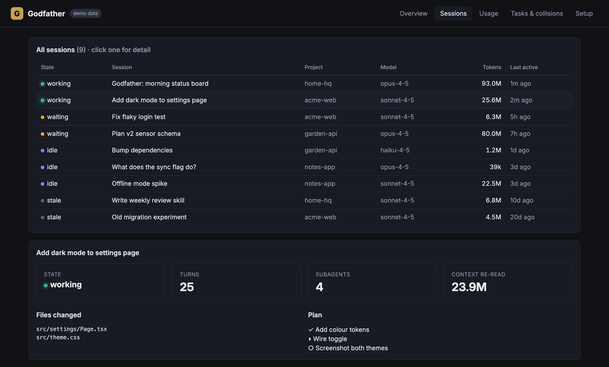
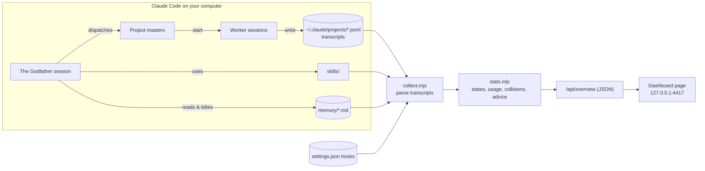

# Godfather

**A supervisor setup for Claude Code.** One pinned session (the Godfather) watches every other session, keeps skills, hooks
and memory tidy, and hands work to the right place. A local dashboard shows what is running, what is waiting on you,
where your tokens went and which sessions are about to edit the same file.


*All screenshots use the made-up demo data that ships with the repo (`npm run demo`).*

## Why

With five or ten Claude Code sessions open, it gets hard to answer simple questions: Which ones are still working? Which
are waiting for me? Are two of them changing the same file? What used up my token budget? The Godfather answers those in
one place, and gives Claude a short set of rules (skills) for running many sessions without chaos.

## Quick start

Needs Node 18+ and bash. No packages to install.

```bash
git clone https://github.com/chamu262/godfather.git && cd godfather
```

```bash
./install.sh
```

```bash
npm run demo
```

Open http://127.0.0.1:4417. `npm run demo` uses made-up data; `npm start` reads your real `~/.claude` folder.
Then, in any Claude Code session, say **"set up the Godfather"**.

## What you get

| Piece | What it does |
|---|---|
| `install.sh` | Copies the skills into `~/.claude/skills/` and the templates into `~/.claude/godfather/`. Never overwrites your files (unless `--force`) and never edits `settings.json`; it prints the hook lines for you to paste. |
| `skills/godfather` | The supervisor's rules: status board, dispatch work instead of doing it, check before reporting, ask before deleting. |
| `skills/session-handoff` | How to hand a big or off-topic task to a fresh session with a brief under 300 words. |
| `skills/tidy-memory` | Merge duplicate memories, fix stale facts, keep `MEMORY.md` a one-line index. |
| `templates/` | A `CLAUDE.md` for the Godfather's folder, a memory layout example and two optional hooks (a start-of-session reminder and a "turn finished" notification). |
| `dashboard/` | A small local web page. No dependencies, no model calls, listens on `127.0.0.1` only, reads files read-only. |
| [`docs/conventions.md`](docs/conventions.md) | Session names, one-task-per-session, reports, memory and safety habits. |

## The dashboard

| | |
|---|---|
|  **Sessions**: every session with its state; click one to see its files, plan and subagents. |  **Usage**: tokens per day, by project, model and session. |
|  **Tasks & collisions**: open plan steps from every session, and files two live sessions are both editing. |  **Setup**: installed skills, memory files and hooks. |

**Session states.** *Working*: activity in the last 5 minutes. *Waiting*: Claude spoke last, within a day, so it is
probably waiting for you. *Idle*: quiet for up to a week. *Stale*: older, a candidate for archiving.

**Advisor.** Plain rules, no AI: flags sessions re-reading huge context (hand them off), quick questions run on the most
expensive model, stale sessions, and a low cache hit. *Cache hit* is the share of input served from Claude's prompt
cache, which is cheaper; a high number is good.

## How it works



- `dashboard/lib/collect.mjs` reads transcripts (one JSON line per message), skills, memory frontmatter and hooks.
- `dashboard/lib/stats.mjs` turns those into states, token totals, collisions, open plan steps and advice.
- `dashboard/server.mjs` serves one JSON endpoint and the static page, which refreshes every 15 seconds.
- `demo/generate.mjs` writes a fictional `.claude` folder (9 sessions across 4 made-up projects) used by the demo and the tests.

Settings: `GODFATHER_PORT` (default 4417) and `GODFATHER_HOME` (default `~/.claude`).

## Tests

```bash
npm test
```

13 tests with Node's built-in test runner: transcript parsing, session states, collisions, advisor rules, the HTTP server
(including a path-escape check) and `install.sh` in a temp folder. CI runs them on Ubuntu and macOS with Node 18 and 22.

## Privacy

Everything stays on your computer. The dashboard binds to `127.0.0.1`, makes no network calls and never writes to
`~/.claude`. It shows numbers about sessions and tokens, never about people.

## License

MIT
