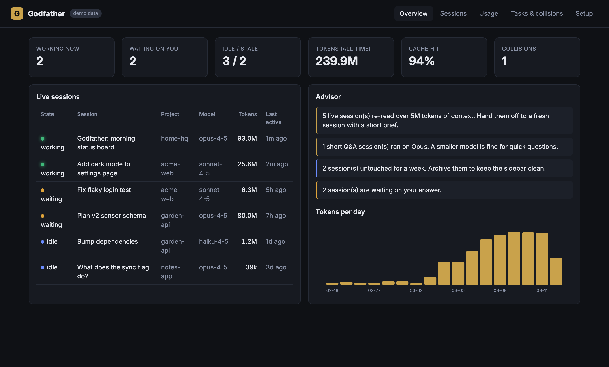
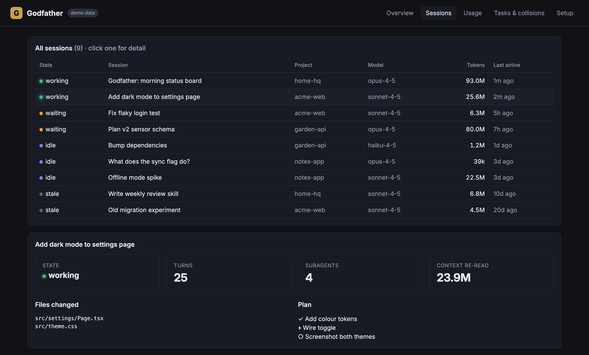
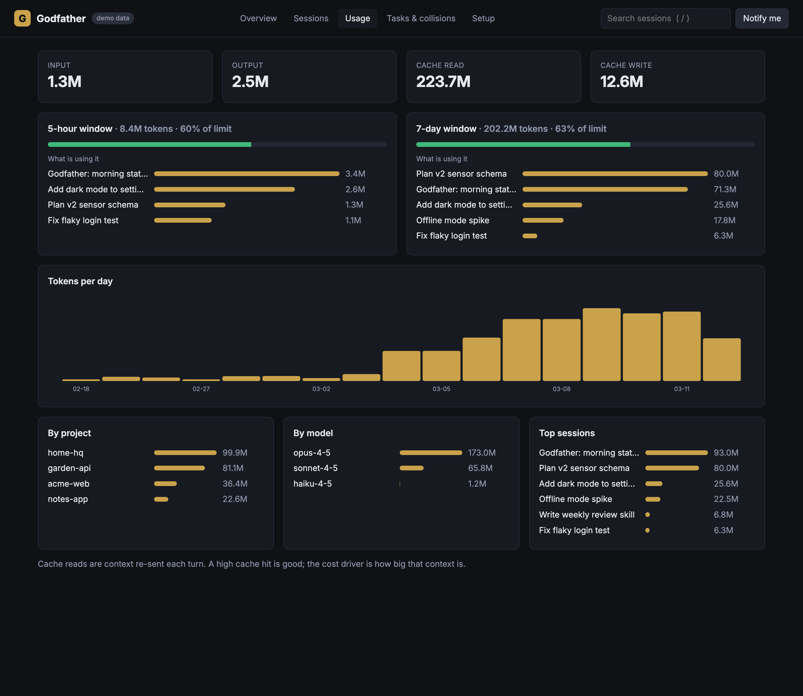
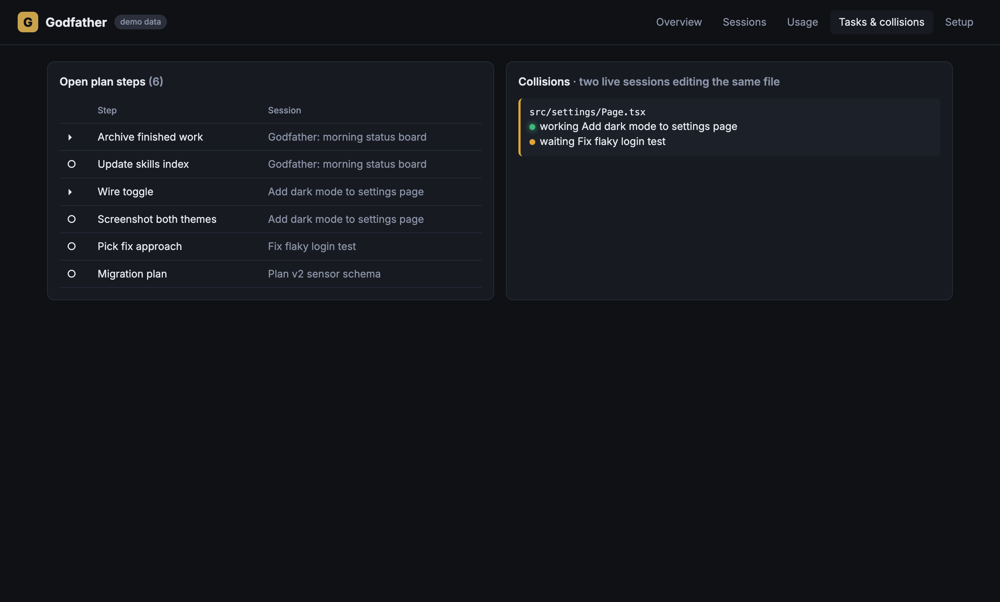
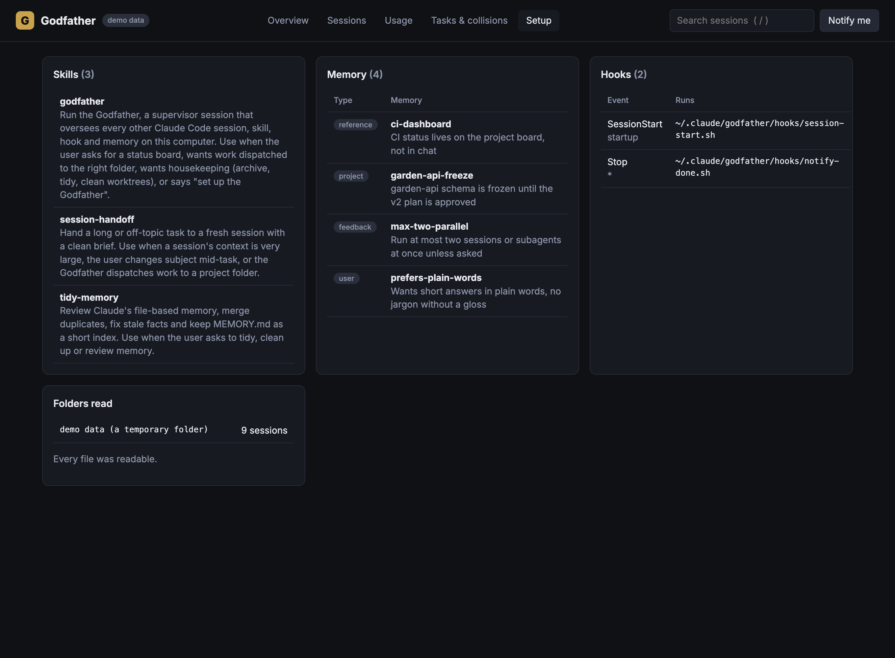

# dashboard/

A small local web page that shows what every Claude Code session on your computer is doing. Plain Node, no packages, no
model calls. It only reads files and listens on `127.0.0.1` (your own computer) only.

```bash
npm run demo     # made-up demo data
```

```bash
npm start        # your real ~/.claude folder
```

Then open http://127.0.0.1:4417.

| File / folder | What it does |
|---|---|
| `server.mjs` | The web server. Serves the page from `public/` and a few read-only JSON endpoints: `/api/overview`, `/api/search?q=`, `/api/session/<id>/handover` and `/api/session/<id>/export`. Anything other than GET is refused. `--demo` builds the demo folder first. |
| [`lib/`](lib/) | The logic: reading session files, turning them into numbers, writing handover briefs. |
| [`public/`](public/) | The page itself: HTML, CSS and the browser script. |

Settings (environment variables): `GODFATHER_PORT` (default 4417), `GODFATHER_HOME` (Claude folder(s) to read, default
`~/.claude`, several separated by `:`), and `GODFATHER_LIMIT_5H` / `GODFATHER_LIMIT_7D` (optional token limits so the usage
windows also show a percentage).

## How it fits

Claude Code writes one transcript file per session. `lib/collect.mjs` reads them, `lib/stats.mjs` works out states,
usage and collisions, `server.mjs` sends that as JSON, and `public/app.js` draws it. The skills in [`../skills`](../skills)
tell Claude how to act on what the dashboard shows.

## Views

| | |
|---|---|
|  **Overview**: counts by state, live sessions, advisor tips, tokens per day. |  **Sessions**: every session; click one for its files, plan and subagents. |
|  **Usage**: tokens by day, project, model and session. |  **Tasks & collisions**: open plan steps, and files two live sessions both edit. |
|  **Setup**: installed skills, memory files and hooks. | |

*Screenshots use the demo data only.*
