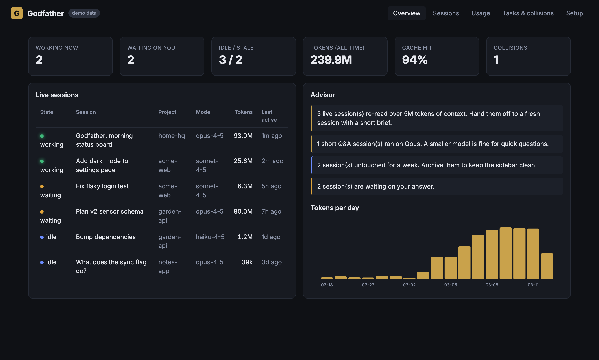

# dashboard/public/

The page you open in the browser. Plain HTML, CSS and JavaScript, with no build step.

| File | What it does |
|---|---|
| `index.html` | The page frame: header, view tabs, search box and a "Notify me" button. |
| `style.css` | Dark theme, cards, tables and bars. Works down to phone width. |
| `app.js` | Fetches `/api/overview` every few seconds and draws the five views. `#sessions/<id>` in the address opens one session's detail. `/` jumps to search. |
| `watch.mjs` | Small helpers with no page code, so the tests can use them. A session's shown state only slows down after it is seen twice in a row (no flicker), and a session that finishes while you look elsewhere is marked "done, unseen". |

