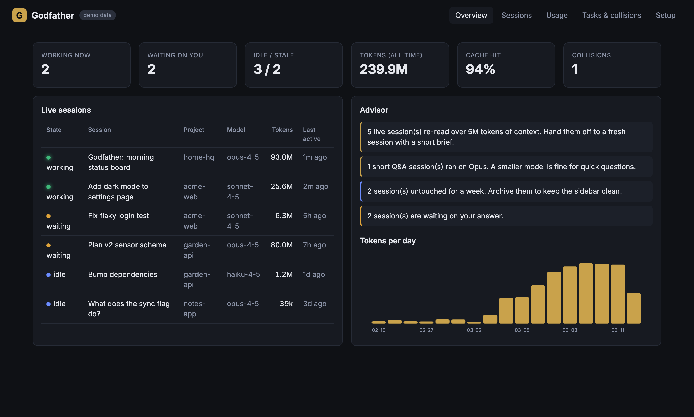

# godfather skill

**What it does:** turns one pinned Claude Code session into a supervisor. It gives a status board (working, waiting on
you, failed, stale), sends real work to a session in the right folder instead of doing it, checks results before calling
them done, and does housekeeping (archiving, cleaning worktrees, grouping the sidebar) only after you say yes.

**When it triggers:** when you ask for a status board, want work dispatched, ask to tidy up, or say "set up the Godfather".

**Install:** run `./install.sh` from the repo root. It copies `SKILL.md` to `~/.claude/skills/godfather/`.

**Use:**
1. Make a folder (for example `~/Godfather`) and copy `~/.claude/godfather/CLAUDE.md` into it.
2. Start a Claude Code session there, title it "The Godfather" and pin it.
3. Say "set up the Godfather", then "status board" whenever you want an update.
4. Keep the dashboard open next to it (`npm start`).

