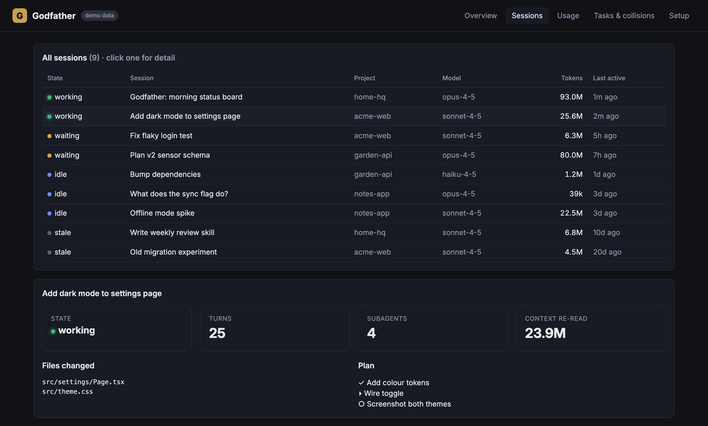

# session-handoff skill

**What it does:** moves a task to a fresh session with a brief under 300 words: goal, where, what is known, rules and what
to report back. A fresh session with a short brief costs less and stays sharper than a long one that re-reads everything
each turn.

**When it triggers:** a session has re-read more than about 5M tokens of context, you change subject mid-task, or the
work belongs in another folder.

**Install:** `./install.sh` from the repo root (copies to `~/.claude/skills/session-handoff/`).

**Use:** say "hand this off" in a long session. The dashboard helps in two ways. The advisor flags sessions that are too
big, and each session's detail has a handover brief you can copy (`/api/session/<id>/handover`).

