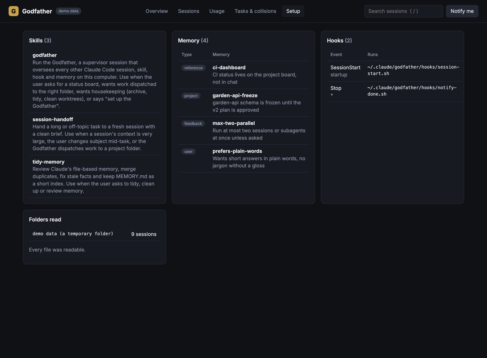

# tidy-memory skill

**What it does:** reviews Claude's memory files (one fact per file, in `~/.claude/projects/<project>/memory/`). It merges
duplicates, flags facts that point to things that no longer exist, turns "next week" into real dates, and rebuilds
`MEMORY.md` as a one-line-per-file index. It shows a before/after list and deletes nothing without your yes.

**When it triggers:** you ask to tidy, clean up or review memory.

**Install:** `./install.sh` from the repo root (copies to `~/.claude/skills/tidy-memory/`).

**Use:** say "tidy my memory". For the file format, see [`templates/memory`](../../templates/memory).

